# ha-matter-card

[](https://www.home-assistant.io/integrations/marketplace/)
[](https://github.com/juju35/ha-matter-card/actions/workflows/hacs.yml)
[](https://github.com/juju35/ha-matter-card/actions/workflows/validate.yml)
[](https://github.com/juju35/ha-matter-card/actions/workflows/lint.yml)
[](https://github.com/juju35/ha-matter-card/releases/latest)
[](https://github.com/juju35/ha-matter-card/blob/main/LICENSE)
[](https://buymeacoffee.com/julienstep9)

<p align="center">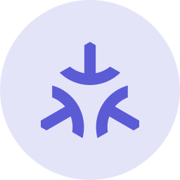</p>

<p align="center">
  <a href="https://csa-iot.org/all-solutions/matter/"></a>
</p>

Your **Matter network** at a glance in Home Assistant: every Matter node with its transport (Thread, Wi-Fi, Ethernet) and its health, the Thread network it runs on, the fabrics it belongs to, under an animated banner where the Matter hub talks to its devices.

The cards are built on top of Home Assistant's [Matter integration](https://www.home-assistant.io/integrations/matter/) and its [Thread integration](https://www.home-assistant.io/integrations/thread/): add the card, and your Matter devices are **found automatically** in the device registry, whatever their names.

[](https://my.home-assistant.io/redirect/marketplace_repository/?owner=juju35&repository=ha-matter-card&category=plugin)

| Matter Card | Matter Mini Card |
|---|---|
| <picture><source media="(prefers-color-scheme: dark)" srcset="https://raw.githubusercontent.com/juju35/ha-matter-card/main/screenshots/card-dark.png">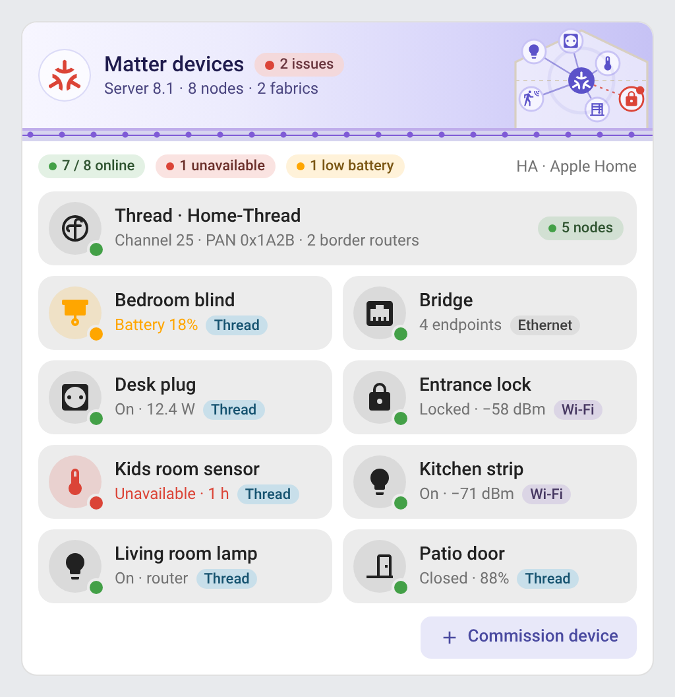</picture> | <picture><source media="(prefers-color-scheme: dark)" srcset="https://raw.githubusercontent.com/juju35/ha-matter-card/main/screenshots/mini-card-dark.png">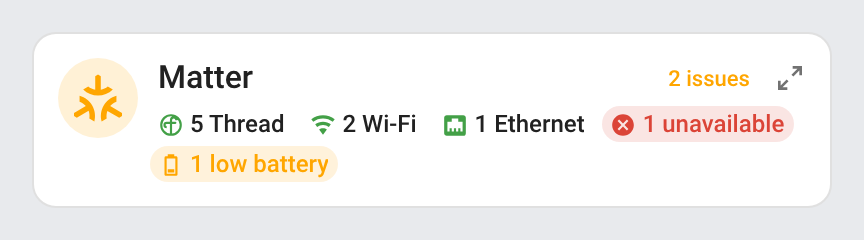</picture> |

## Features

- Two cards: a full **Matter Card** and a compact **Matter Mini Card**, of type `custom:matter-card` and `custom:matter-mini-card`
- An animated 90 px banner: a house section with the Matter hub at its centre linked to six devices (light, plug, thermometer, motion sensor, lock, blind), packets travelling along the links, on a purple network ground strip; when a node is unreachable, a device and its link turn red and the device blinks
- The Matter badge takes the colour of the network's status: purple when healthy, amber for a low battery, red for an unreachable node, grey without any node
- The banner's statistics: the Matter Server version (from its update entity, when there is one), the number of nodes and of fabrics
- Status chips under the banner: **11 / 12 online**, **1 unavailable** (red), **1 low battery** (amber), with the names of the fabrics on the right (« HA · Apple Home »)
- A **Thread network** tile: network name, channel, PAN ID and number of border routers, with its node count
- One 56 px tile per Matter node, two per row: the icon of its main entity, its name, a state line and a coloured **transport tag** — **Thread** (blue), **Wi-Fi** (purple), **Ethernet** (grey) — with a status dot. The state line shows the main entity's state with one reading: the power of a plug, the Wi-Fi signal (« −58 dBm »), the Thread router role, or the battery
- Healthy tiles stay neutral: only issues are coloured — a low battery in amber (« Battery 18% »), an unavailable node in red (« Unavailable · 1 h »)
- Click a node for its detail, in a popup at the top of the card: node ID, vendor and product, firmware, network, role, IP and MAC addresses, Wi-Fi signal, last seen, fabrics, and a button to the device page; it closes with its button, a click anywhere else, Escape, or when the card leaves the page
- A **Commission device** button (administrators) opening Home Assistant's Matter add-device dialog
- Mini card: the same 90 px banner with the Matter badge, the status of the network (« Healthy », « 2 issues »), the Thread / Wi-Fi / Ethernet counts and the issues as chips, and a detail button at the top right that unfolds the full card; a click anywhere outside the card folds it back
- Night banner with the dark theme of Home Assistant (a light theme keeps the day banner after sunset), or forced with `illustration_theme`; `illustration: false` for a classic header with a round icon
- Visual editor for both cards; options left at their default are kept out of the YAML
- Light and dark themes, `prefers-reduced-motion` honoured (everything stays still)
- English, French, German, Spanish, Serbian (Cyrillic and Latin), Italian, Dutch, European Portuguese, Polish, Romanian, Danish, Swedish, Bulgarian, Russian, Ukrainian, Hungarian, Slovak, Czech, Slovenian, Latvian and Greek
- Single file, no external dependency: the banner and the icons are drawn in SVG

## Supported integrations

| Integration | What the cards show |
|---|---|
|  [Matter](https://www.home-assistant.io/integrations/matter/) (Matter Server) | The Matter devices of the device registry, their entities (state, battery, power, Wi-Fi signal, Thread role), and the node diagnostics of the integration's `matter/node_diagnostics` websocket command (network type, node type, IP and MAC addresses, fabrics). The time a node was last seen comes from `matter/network_topology` when the Matter Server supports it |
|  [Thread](https://www.home-assistant.io/integrations/thread/) | The preferred Thread dataset (`thread/list_datasets`: network name, channel, PAN ID) and the border routers it discovers (`thread/discover_routers`) |

## Prerequisites

- Home Assistant 2024.8 or later
- The [Matter integration](https://www.home-assistant.io/integrations/matter/), connected to a Matter Server, with at least one device
- Optionally the [Thread integration](https://www.home-assistant.io/integrations/thread/) for the Thread network details. The Thread dataset, the border routers, the last-seen times and the commission button need an administrator account; for other users the Thread tile shows what the Thread nodes report (network name, channel)

## Installation

### Via the Marketplace (recommended)

Click the button below to add the repository directly:

[](https://my.home-assistant.io/redirect/marketplace_repository/?owner=juju35&repository=ha-matter-card&category=plugin)

Then click **Install**, and reload your browser when the Marketplace asks you to.

Or manually:

1. Open **Settings → Marketplace → Add from link** (top right; this needs a GitHub account connected)
2. Add `https://github.com/juju35/ha-matter-card` — Category: **Dashboard** (Lovelace)
3. Open **Matter Card** and click **Install**
4. Clear your browser cache and refresh

The Marketplace registers the dashboard resource for you (`/local/community/ha-matter-card/matter-card.js`); the single file provides both cards.

### Manual

1. Download `matter-card.js` and the `matter-card.i18n.*.js` translation files from the [latest release](https://github.com/juju35/ha-matter-card/releases/latest)
2. Copy them all to `/config/www/` (without the translation files, the cards show in English)
3. Go to **Settings → Dashboards → ⋮ → Resources** → Add resource:
   - URL: `/local/matter-card.js`
   - Type: **JavaScript Module**
4. Clear your browser cache and refresh

## Configuration

### Visual editor

Edit a dashboard, click **Add card** and search for **Matter Card** or **Matter Mini Card**. The Matter devices are found by themselves; set the title, the sort order, the columns, the low battery threshold, the banner theme, the parts to show and the language. The preview updates live, and options left at their default are kept out of the generated YAML. The mini card's editor also has the full card's options, used by its unfolded view. Only `exclude`, a list, is set in YAML.

### Minimal

```yaml
type: custom:matter-card
```

```yaml
type: custom:matter-mini-card
```

### Full options

```yaml
type: custom:matter-card
title: Matter devices
show_title: true
show_subtitle: true
sort: status
columns: 2
battery_threshold: 20
show_thread: true
show_commission: true
show_bridged: false
illustration: true
illustration_theme: auto
exclude:
  - Test bulb
language: en
```

```yaml
type: custom:matter-mini-card
title: Matter
sort: status
zoom: true
```

### Options reference

| Option | Card | Default | Description |
|---|---|---|---|
| `title` | both | `Matter devices` / `Matter` | Card title (the banner's name; the mini card's title) |
| `show_title` | both | `true` | Show the title in the header (e.g. `false` under a section heading of your own); the status pill stays |
| `show_subtitle` | both | `true` | Show the stats line under the title (Matter Server version, nodes, fabrics) |
| `sort` | both | `name` | Order of the node tiles: `name`, or `status` for the issues first (unavailable, then low battery) |
| `columns` | both | `2` | Node tiles per row (1 to 4); a card narrower than 390 px shows one per row |
| `battery_threshold` | both | `20` | A battery below this percentage is a low battery (a battery binary sensor that is on is one too) |
| `show_thread` | both | `true` | The Thread network tile |
| `show_commission` | both | `true` | The **Commission device** button (shown to administrators only) |
| `show_bridged` | both | `false` | Also show the devices bridged by a Matter bridge as tiles (otherwise counted as the bridge's endpoints) |
| `illustration` | both | `true` | The animated banner as header (both cards); `false` for a classic header with a round icon |
| `illustration_theme` | both | `auto` | `auto` (follows the Home Assistant theme: night with a dark theme, day with a light theme), `day` or `night` |
| `exclude` | both | — | **YAML only.** Devices left out of the cards: a list of device ids or device names |
| `zoom` | mini | `true` | Detail button at the top right: unfolds the full card and back (`false` removes it). The full card's options above apply to the unfolded view and are also set in the mini card's visual editor |
| `language` | both | Auto | Force language: `en`, `fr`, `de`, `es`, `sr`, `sr-Latn`, `it`, `nl`, `pt`, `pl`, `ro`, `da`, `sv`, `bg`, `ru`, `uk`, `hu`, `sk`, `cs`, `sl`, `lv` or `el` (auto-detects from HA settings) |

## Screenshots

### Animations

The links from the Matter hub to its devices flow, and the packets pulse along the strip, in a 6-second loop. With `prefers-reduced-motion`, everything stays still.

A healthy network:

| Light | Dark |
|---|---|
| 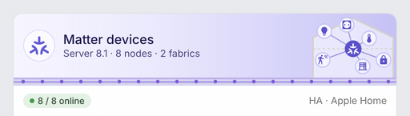 | 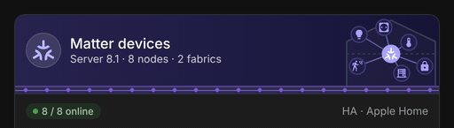 |

A node unavailable — its device and its link turn red, the device blinks:

| Light | Dark |
|---|---|
| 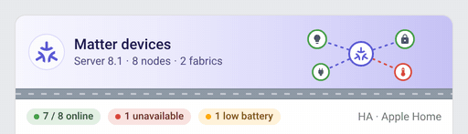 | 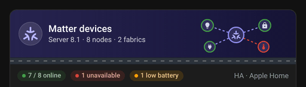 |

### Matter Card

One node unavailable, one low battery:

| Light | Dark |
|---|---|
|  | 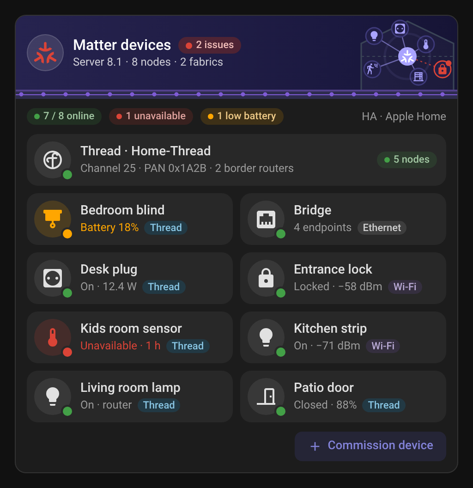 |

Every node online:

| Light | Dark |
|---|---|
| 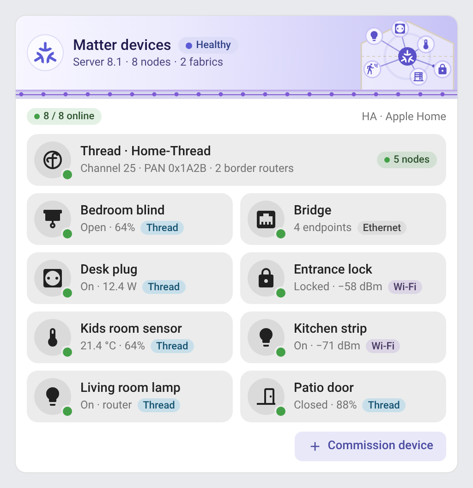 | 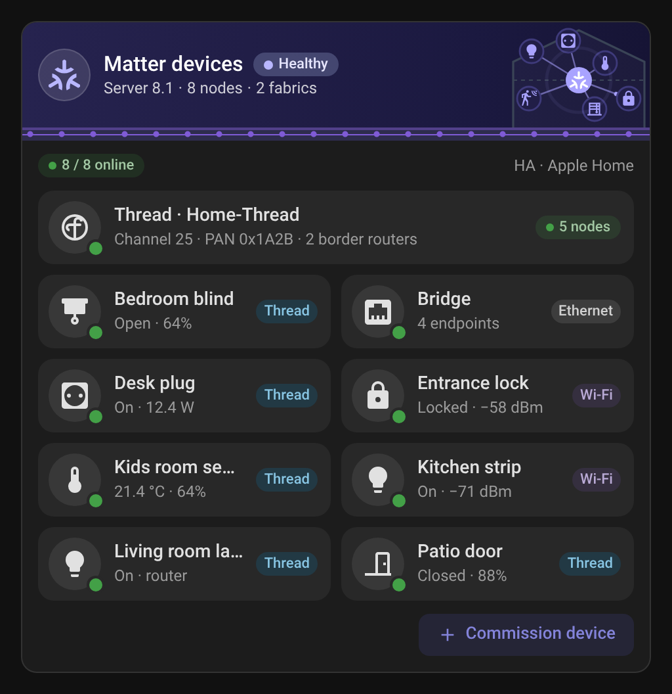 |

Detail of a node, at the top of the card:

| Light | Dark |
|---|---|
| 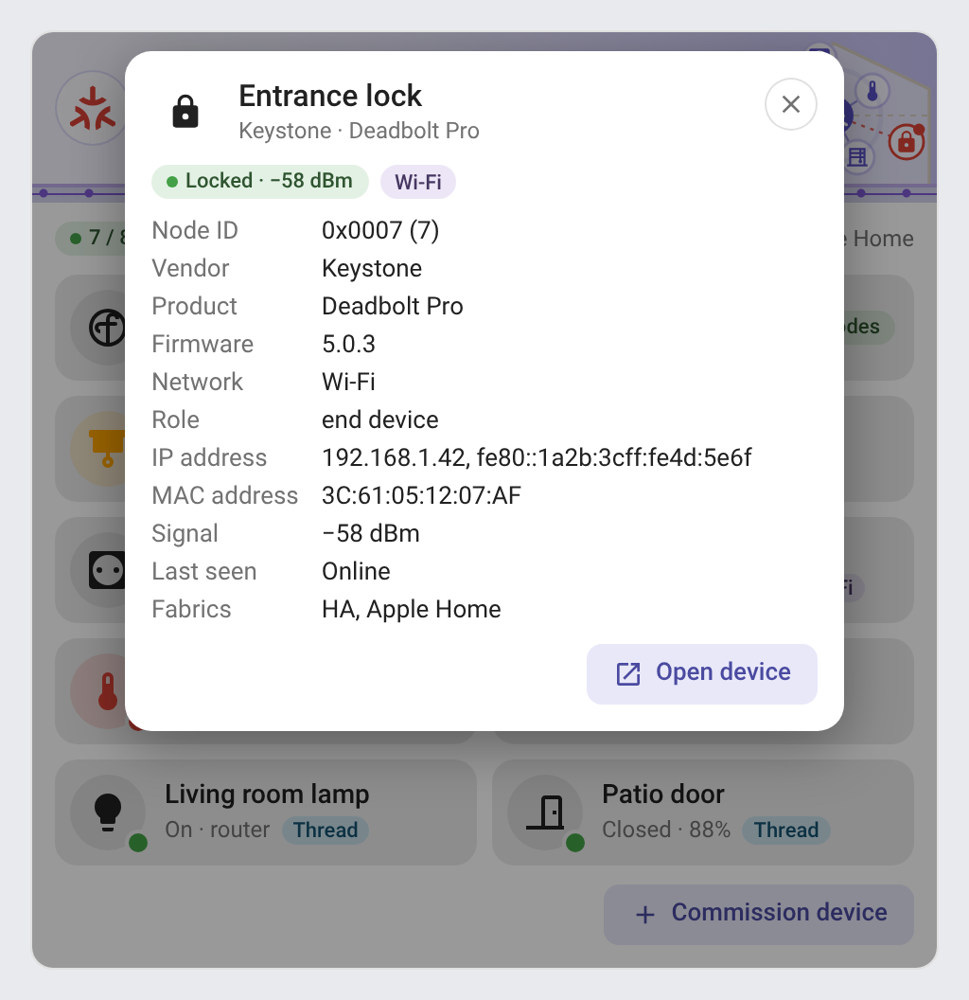 | 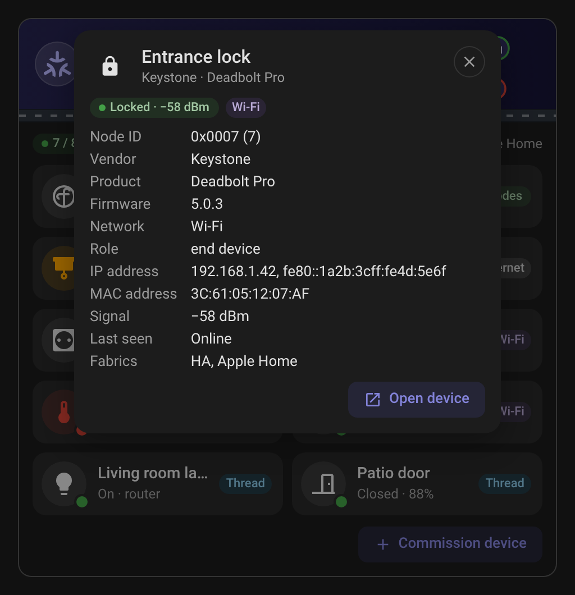 |

Classic header (`illustration: false`, here with `sort: status`):

| Light | Dark |
|---|---|
| 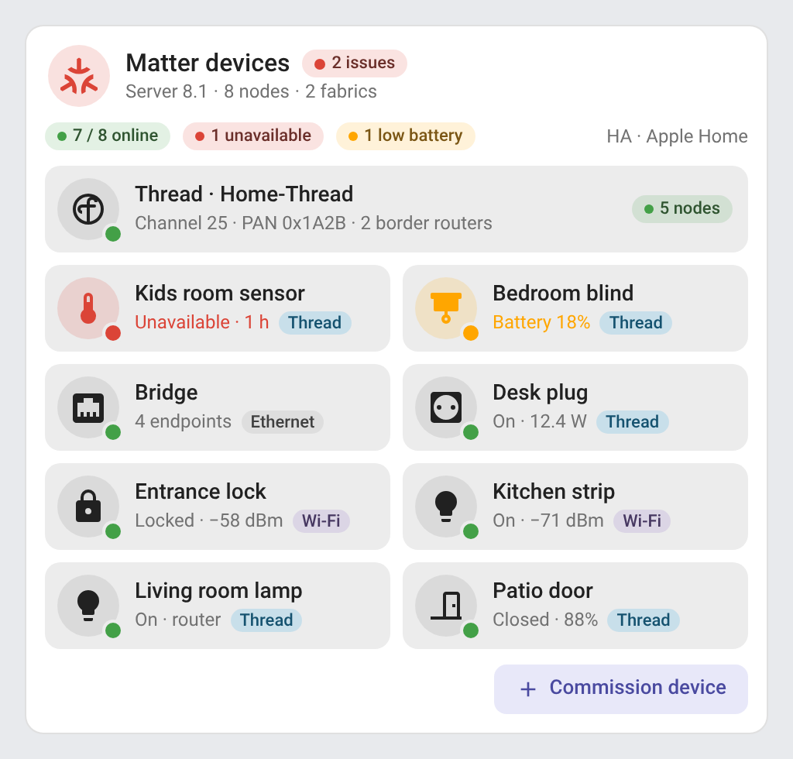 | 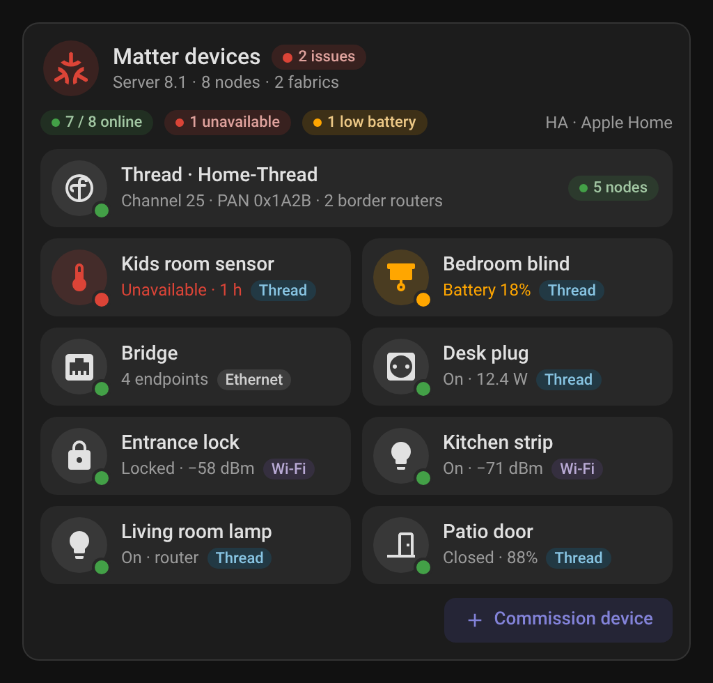 |

### Matter Mini Card

| Light | Dark |
|---|---|
|  | 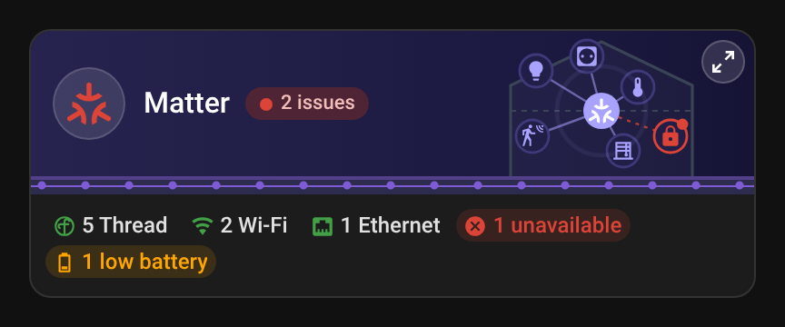 |
|  |  |

Unfolded with its detail button (top right; click it again or anywhere outside the card to go back):

| Light | Dark |
|---|---|
| 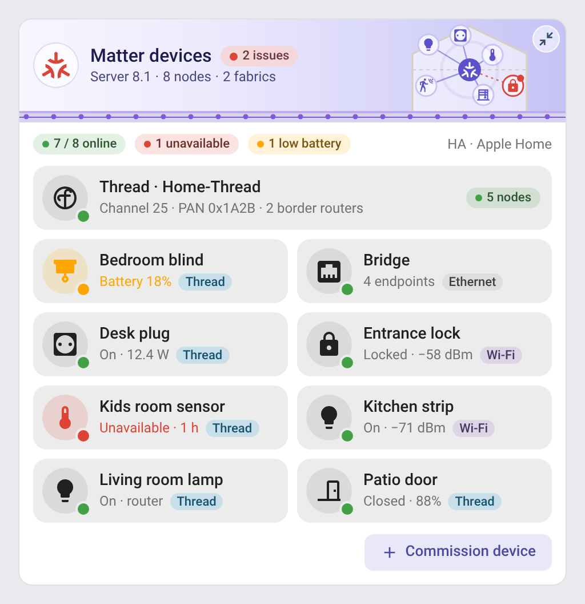 | 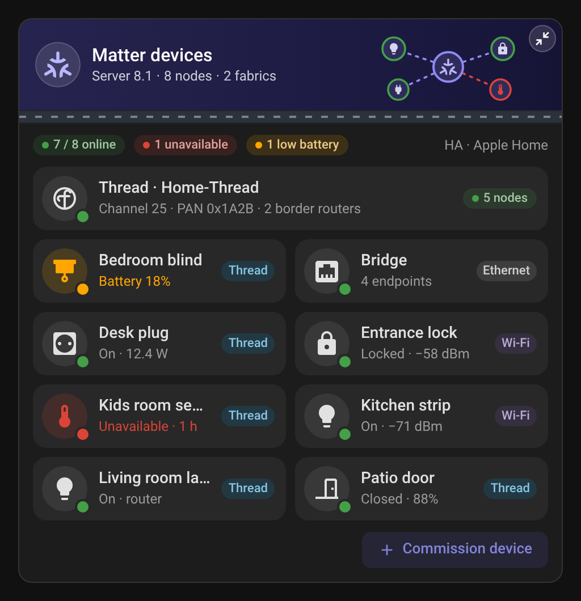 |

## How it works

### Nodes

The cards read the device registry: a Matter device carries a `matter` identifier, `deviceid_<fabric>-<node id>-MatterNodeDevice` for a node, `…-<endpoint>` for a device bridged by a node. Each node is a tile; the bridged devices count as their bridge's endpoints unless `show_bridged` is on. A node's main entity is the first of its entities that is not a diagnostic or configuration entity, a lock, light, cover or climate before a switch, a binary sensor before a sensor; its battery, power, Wi-Fi signal (`wifi_rssi`) and Thread role (`thread_routing_role`) come from its other entities.

A node is unavailable when Home Assistant marks its entities unavailable (the Matter integration does when the node stops answering); the state line then says since when.

### Diagnostics

For each node, the cards ask the Matter integration's `matter/node_diagnostics` websocket command once, then every 10 minutes and whenever the node comes back or drops out: its network type (the transport tag), node type, Thread network name, IP and MAC addresses and fabrics. Until the answer is in, the transport is read from the node's diagnostic sensors. The answers are shared by every card of the page.

### Thread network

For an administrator, the Thread tile shows the preferred dataset of the Thread integration (`thread/list_datasets`) and counts the border routers its discovery sees on that network (`thread/discover_routers`, subscribed while a card is shown). For other users, the network name and the channel come from the Thread nodes themselves. The tile stays neutral while a single Thread node is down (that node's tile shows it), and turns red when none answers.

### Narrow cards

The full card fits down to 8 columns of a sections view (about 208 px on a phone), the mini card down to 6 columns (about 156 px). Under 390 px the node tiles go one per row; under 300 px the banner keeps its sky and ground strip for its texts, without the scene. In a container sized by its content, the cards take a width of 400 px instead of collapsing.

## Development

```bash
npm install
npm run build        # bundles src/matter-card.js into dist/matter-card.js and stamps the version of package.json
npm run check        # builds and checks the bundle (run in CI)
npm test             # unit tests, and the browser layout tests (Chromium through Playwright)
npm run screenshots  # renders the cards with mock data (scripts/screenshots/mock.mjs) into screenshots/, and the animation GIFs (needs ffmpeg)
```

The source is split into ES modules under `src/` (entry `src/index.js`); `npm run build` assembles them (`scripts/bundle.mjs`) into the single file the Marketplace serves.

`dist/` is not committed: `npm run build` creates it locally, CI builds it on every push, and the release workflow attaches the built file to the release, which is where the Marketplace installs it from. The **Screenshots** workflow renders the captures again on every pull request that changes the sources and commits them to its branch.

### Releasing

1. Bump `version` in `package.json` (and `package-lock.json`)
2. Add a `## <version>` section at the top of [CHANGELOG.md](https://github.com/juju35/ha-matter-card/blob/main/CHANGELOG.md)
3. Merge to `main`: the **Release** workflow builds the card, creates the tag and the GitHub release with the changelog section as notes, and attaches `matter-card.js` and its translation files

## Translations

The cards auto-detect the language from your Home Assistant settings. Currently supported:

| Language | Code |
|---|---|
| English | `en` |
| Français | `fr` |
| Deutsch | `de` |
| Español | `es` |
| Српски (Serbian, Cyrillic) | `sr` |
| Srpski (Serbian, Latin) | `sr-Latn` |
| Italiano | `it` |
| Nederlands | `nl` |
| Português (Portugal) | `pt` |
| Polski | `pl` |
| Română | `ro` |
| Dansk | `da` |
| Svenska | `sv` |
| Български | `bg` |
| Русский | `ru` |
| Українська | `uk` |
| Magyar | `hu` |
| Slovenčina | `sk` |
| Čeština | `cs` |
| Slovenščina | `sl` |
| Latviešu | `lv` |
| Ελληνικά | `el` |

Contributions for additional languages are welcome!

## Contributing

Issues and pull requests are welcome: bug reports with your card configuration and a browser console extract, ideas, and translation fixes. Before opening a pull request, run `npm test` and `npm run check`; the screenshots are rendered by the CI on the pull request.

## Credits

Node data from Home Assistant's [Matter integration](https://www.home-assistant.io/integrations/matter/) and [Matter Server](https://github.com/home-assistant-libs/python-matter-server), Thread data from its [Thread integration](https://www.home-assistant.io/integrations/thread/). Matter and the Matter logo are trademarks of the Connectivity Standards Alliance; Thread is a trademark of the Thread Group; this project is not affiliated with either. The devices, vendors and networks of the screenshots are fictional.

## License

[MIT](https://github.com/juju35/ha-matter-card/blob/main/LICENSE)

## Support

If you find this project useful, you can support its development:

<a href="https://buymeacoffee.com/julienstep9"></a>
